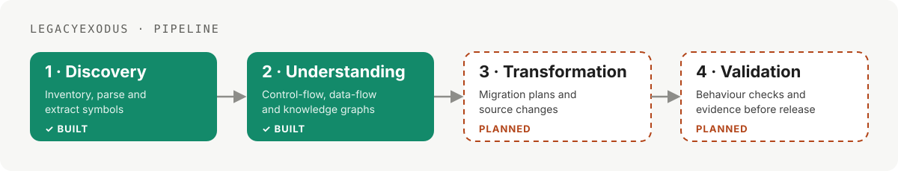
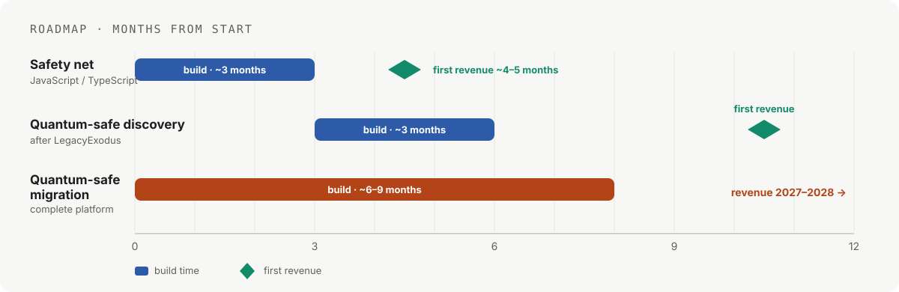

<div align="center">


<br/>

[](https://legacyexodus.tech)
[](https://www.linkedin.com/in/raitaskeen)
[](mailto:founder@legacyexodus.tech)
[](https://raitaskeen.me)

</div>

---

## ✦ About

I build software that makes legacy systems **understandable and safe to change**. I founded **LegacyExodus**, a migration platform that analyses existing codebases deterministically and produces source-traceable evidence before any change is made. My work spans static analysis, full-stack web applications, commerce platforms and the infrastructure that runs them on Cloudflare.

| Principle | What it means in practice |
|---|---|
| 🔬 **Deterministic first** | Correctness comes from analysis and tests. AI supports reasoning and summarisation, never the source of truth. |
| 🧭 **Explicit uncertainty** | Unsupported behaviour is reported, never silently dropped. |
| ✅ **Verified delivery** | Every change ships with tests, a reviewed pull request and passing CI. |

---

## ◆ The LegacyExodus pipeline

Discovery and understanding are built and tested. Transformation and validation are the next stages.

<div align="center">

</div>

---

## ◆ Roadmap

LegacyExodus is built in stages, starting with the languages most in demand for modernisation.

<div align="center">

</div>

| Product | First version | First revenue |
|---|---|---|
| Safety net (JavaScript / TypeScript) | ~3 months | ~4–5 months |
| Quantum-safe discovery | ~3 months after LegacyExodus | ~4–5 months after that |
| Quantum-safe migration (complete) | ~6–9 months | 2027–2028 |

**Language order:** JavaScript → TypeScript → TSX / JSX → Node.js, then PHP → Ruby on Rails → Java.

---

## ◆ Projects

### 🧬 LegacyExodus
 [](https://legacyexodus.tech)

A deterministic repository-intelligence and static-analysis engine for JavaScript and TypeScript. It inventories a repository, parses source with Babel, builds symbol, dependency, control-flow (CFG) and data-flow (DFG) artifacts, and publishes validated JSON with manifest hashes.

- **Reproducible:** the same input always produces the same output, independent of locale.
- **Evidence over guesses:** unresolved or unsupported constructs stay visible in the output.
- **Run isolation:** SQLite-backed storage, snapshot reuse and integrity-checked artifacts.

   

---

### 🔎 LegacyExodus Analysis Sample
 [](https://github.com/LegacyExodus/legacyexodus-analysis-sample)

A sanitised, public sample of the engine's core: AST-driven control-flow graphs, reachability analysis, structural invariant checks and explicit reporting of unsupported semantics. It includes unit tests and a visual CFG demo.

```bash
bun run analyze sample.ts     # analyse the sample
bun run demo                  # open the visual CFG at http://localhost:3000
```

  

---

### 🛒 Raavi Volt · amirstore.tech
 [](https://amirstore.tech) [](https://github.com/raitaskeen/raavi-volt)

An online store for Geepas and other electrical appliances, serving Lahore and Pakistan. The name combines the Ravi river of Lahore with "volt".

- **Shopping:** search, filters, live deals, cart and checkout.
- **Payments:** manual bank and Raast QR payments, with payment-proof upload and order tracking.
- **Operations:** admin dashboard for products, orders, payment verification and low-stock alerts.
- **Customers:** optional WhatsApp order updates and an installable app (PWA); every order is re-priced from the database on the server.

    

---

### 🏛️ Annemarie-Schimmel-Haus Website
 [](https://annemarie-schimmel.raitaskeen.workers.dev/en) [](https://github.com/raitaskeen/annemarie-schimmel-haus)

A bilingual (English and German) website and staff workspace for a German cultural centre in Lahore.

- **Learning:** courses and batches, placement tests, events with registration.
- **Applications:** online course applications in five steps, with documents and a reference number.
- **Guide:** Schimmel, an assistant that answers from the centre's own course information.
- **Staff:** roles, applications, payments, messages and an audit trail of every staff action.

    

---

### 🧩 ASH Digital Platform
 [](https://github.com/raitaskeen/ash-digital-platform)

The next-generation digital platform concept for the same centre: public web, institutional operations, teacher and student experiences, and verifiable credentials. Built as one platform with role-based access for administrators, teachers and students, developed against documented acceptance gates. Hosted production is not yet approved.

    

---

### 🎬 Cine Vault
 [](https://github.com/raitaskeen/cine-vault-web) [](https://github.com/raitaskeen/cine-vault-api)

A movie discovery platform with real-time search, dynamic filters and a responsive interface. The client and the REST API live in separate repositories.

     

---

### ⚙️ AxiomExodus


Rust-native, local-first infrastructure for deterministic data processing and verification, with language-model reasoning kept bounded and deterministic compute underneath.


---

## ◆ Open source

| Project | Contribution |
|---|---|
| [freeCodeCamp](https://github.com/freeCodeCamp/freeCodeCamp) | Open-source coding curriculum · [PR #69385](https://github.com/freeCodeCamp/freeCodeCamp/pull/69385) |
| [MDN Web Docs](https://github.com/mdn) | Web platform documentation · [PR #281](https://github.com/mdn/translated-content-de/pull/281) |
| [Kana Dojo](https://github.com/lingdojo/kana-dojo) | Japanese learning platform · [PR #27003](https://github.com/lingdojo/kana-dojo/pull/27003) |

---

## ◆ Toolkit

<div align="center">

[](https://skillicons.dev)
[](https://skillicons.dev)
[](https://skillicons.dev)

</div>

**Focus areas:** static analysis and program representation (AST · CFG · DFG · IR) · software modernisation and migration · full-stack web applications · commerce and payments · CI/CD and developer tooling · Cloudflare and serverless deployment.

---

<div align="center">

### Let's talk

[](mailto:founder@legacyexodus.tech)
[](https://www.linkedin.com/in/raitaskeen)
[](https://raitaskeen.me)
[](https://x.com/raitaskeen786)

<sub>Built with care in Lahore · legacyexodus.tech</sub>

</div>
