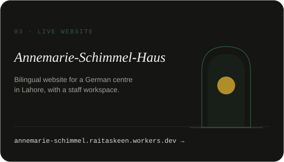

I founded LegacyExodus, where we build deterministic analysis for legacy code: it reads JavaScript and TypeScript, records evidence, and reports what it cannot prove. Before that I spent most of my time on full-stack products with Next.js, React, TypeScript, Node.js, PostgreSQL and Cloudflare Workers. Rust is my favourite language for infrastructure, where correctness and speed both matter.

 

<table>
<tr>
<td width="50%"></td>
<td width="50%"></td>
</tr>
<tr>
<td width="50%"></td>
<td width="50%"></td>
</tr>
</table>

 

**Coming next:** AxiomExodus, a Rust-native platform for deterministic data processing and verification, and quantum-safe discovery for LegacyExodus.

 

   

